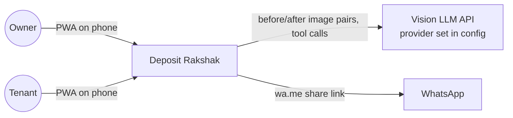
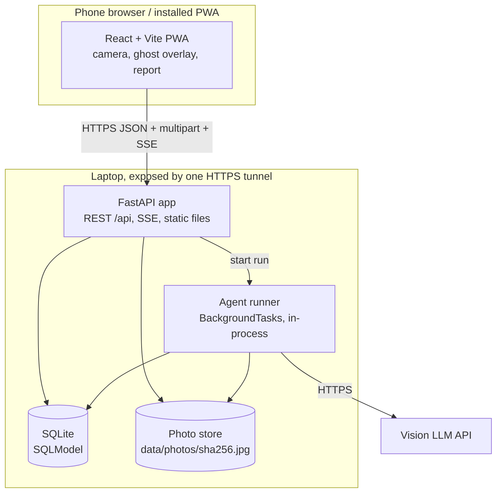
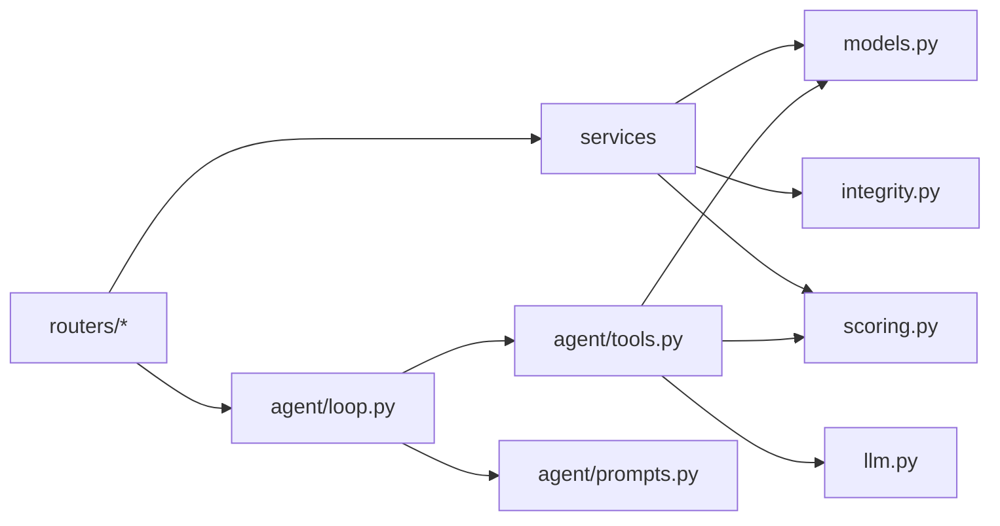
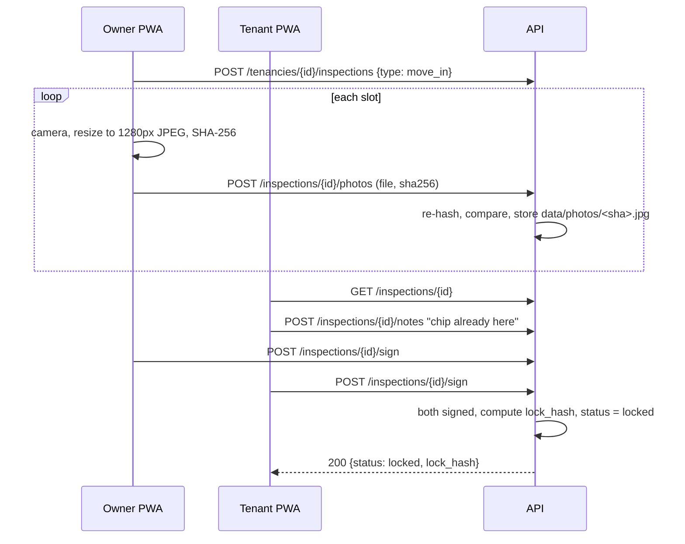
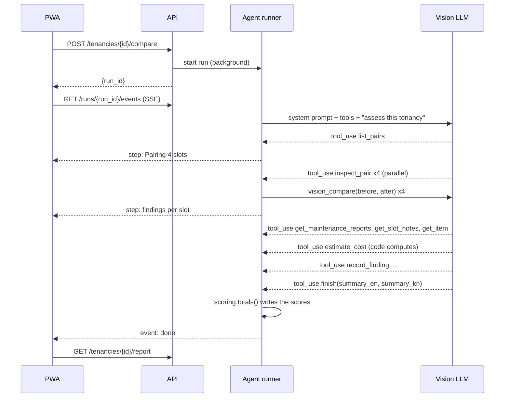

# Deposit Rakshak: Architecture

Read with [SPEC.md](SPEC.md). Section numbers like "SPEC §8" point there.

---

## 1. System context (C4 level 1)



- **Owner and Tenant** each use their own phone. The tenant must see and sign the same record.
- **Vision LLM** is the only external service. It's reached through one adapter (`llm.py`).
- **WhatsApp** is just a share link. There is no integration to build.

---

## 2. Containers (C4 level 2)



| Container | Tech | Responsibility |
|---|---|---|
| PWA | React 18, Vite, vite-plugin-pwa, React Query | Screens, in-app camera, hashing photos before upload, live trace, report |
| API | FastAPI, Uvicorn, SQLModel, PyJWT | Auth, CRUD, upload checks, locking, starting runs, SSE, **serving the built PWA** |
| Agent runner | Python asyncio inside the API process | Tool-use loop, vision calls, writing findings and steps |
| SQLite | A single file, `data/app.db` | All entities in SPEC §5 |
| Photo store | Local disk | Files named by content hash, immutable |

**One origin.** In the demo, FastAPI serves the built PWA from `/` and the API from `/api`. One tunnel URL covers both, so there's no CORS and only one HTTPS certificate. During development, Vite's dev server proxies `/api` to `localhost:8000`.

---

## 3. Backend components (C4 level 3)



| Module | Owns | Rules |
|---|---|---|
| `routers/` | HTTP shapes, auth, role checks | No business logic beyond validation |
| `models.py` | SQLModel tables | The single source of the schema |
| `integrity.py` | SHA-256 of photos, `lock_hash` | Pure functions, unit tested |
| `scoring.py` | Penalty, depreciation, cost, totals | **Pure functions, unit tested first.** The LLM never computes money. |
| `agent/loop.py` | Iteration cap, time limit, step logging, concurrency of at most 4 | Writes `AgentStep` rows before and after every tool call |
| `agent/tools.py` | The tools in SPEC §8 | Database tools are read-only except `record_finding`, `flag_retake` and `finish` |
| `agent/prompts.py` | System prompt, decision rules, vision contract | Versioned string constants |
| `llm.py` | `chat_with_tools(...)` and `vision_compare(...)` | The only file that knows the provider |
| `seed.py` | Demo data (SPEC §14) | Safe to run repeatedly: it wipes and reseeds |

---

## 4. Key flows

### 4.1 Move-in: capture, sign, lock


### 4.2 Move-out comparison: the agent run


### 4.3 Dispute
Tenant `PATCH /findings/{id} {status: disputed, note}`, the API recomputes the totals, and both phones pick up the new numbers through 3-second polling of `/report`.

---

## 5. State machines

**Inspection**
```
draft --(first photo)--> draft
draft --(one party signs)--> awaiting_signatures
awaiting_signatures --(second party signs)--> locked   [lock_hash written, all writes return 409]
```
Signing requires every slot to have a photo.

**Finding**
```
created by agent --> proposed        (confidence >= 0.6)
created by agent --> needs_review    (confidence < 0.6)
proposed / needs_review --(tenant)--> accepted | disputed
disputed --(owner override or tenant accepts)--> accepted
```

**AgentRun:** `running --> done | failed`. On failure, the steps written so far are kept and the UI shows the error step.

---

## 6. Deployment (hackathon)

**Decision:** everything runs on the laptop, exposed by ngrok on its free static domain. There's no cloud hosting.

```
laptop
 ├─ backend:  uvicorn app.main:app --host 0.0.0.0 --port 8000
 ├─ frontend: npm run build:backend  -> copied to backend/app/static (served at /)
 └─ tunnel:   ngrok http --url=<your-static-domain>.ngrok-free.app 8000
phones open https://<your-static-domain>.ngrok-free.app, then "Add to Home Screen"
```

- **The static domain never changes**, so the installed PWA keeps working across restarts.
- **ngrok's free-plan warning page:** the first visit in a browser shows a "You are about to visit" page. Tap **Visit Site** once on each phone. The API wrapper (`api.ts`) also sends the header `ngrok-skip-browser-warning: true` on every request.
- **The service worker must not cache `/api`.** In vite-plugin-pwa, set `workbox.navigateFallbackDenylist: [/^\/api/]`.
- **Laptop:** plugged in, sleep off, and the lid open (on macOS, closing the lid sleeps the laptop). Keep a phone hotspot ready if the venue Wi-Fi drops.

**Environment variables** (`backend/.env`, never committed):
| Var | Purpose |
|---|---|
| `LLM_PROVIDER` | e.g. `watsonx` or `anthropic` |
| `LLM_API_KEY`, `LLM_MODEL`, plus provider-specific ones (project ID, URL) | The provider call |
| `JWT_SECRET` | Signing tokens |
| `DEMO_MODE` | `1` replays the recorded run from `data/demo_run.json` |
| `DEMO_OTP` | Defaults to `123456` |

---

## 7. Non-functional targets

| Concern | Target |
|---|---|
| Agent run, 4 slots | Under 60 s typical, 3 min hard limit |
| Photo upload | Under 300 KB per photo after resize |
| Camera | Works in installed PWA mode on Android Chrome and iOS Safari, over HTTPS |
| Explainability | Every rupee traces to rate card row × quantity × depreciation |
| Offline | The app shell loads offline. Capture needs a network connection (queuing offline is stretch). |

---

## 8. Security and privacy

- JWT on every `/api` route except the two OTP routes. Role checks happen per tenancy.
- Both parties see everything on their tenancy. Nobody sees another tenancy.
- Locked inspections can't be changed (409). Photos are stored by hash and never overwritten.
- No API keys in the frontend. All LLM calls go through the backend.
- Demo OTP only. Real SMS OTP would come after the hackathon.

---

## 9. Architecture decisions (ADRs)

| # | Decision | Alternatives | Why |
|---|---|---|---|
| 1 | SQLite + SQLModel | Postgres, Supabase | Nothing to provision. The SQLModel schema ports to Postgres later. |
| 2 | BackgroundTasks + SSE | Celery or RQ + websockets | No broker. SSE is one-way and needs only `EventSource` on the client. |
| 3 | **Code prices, the LLM proposes** | LLM outputs the cost | Explainable money. Nobody trusts a number a model invented. |
| 4 | Pairing by `slot_id` | Image matching or OpenCV | Deterministic, instant, and nothing to tune |
| 5 | Camera-only capture + hash + lock | Gallery uploads | Deters reused photos and gives a tamper-evident record |
| 6 | One origin for API and PWA | Separate hosts | One tunnel, no CORS, camera over HTTPS works |
| 7 | One LLM adapter file | Provider SDK calls spread around | The provider can change at the last minute |
| 8 | Polling for two-phone sync | Websockets | 3-second polling is good enough and has no extra moving parts |
